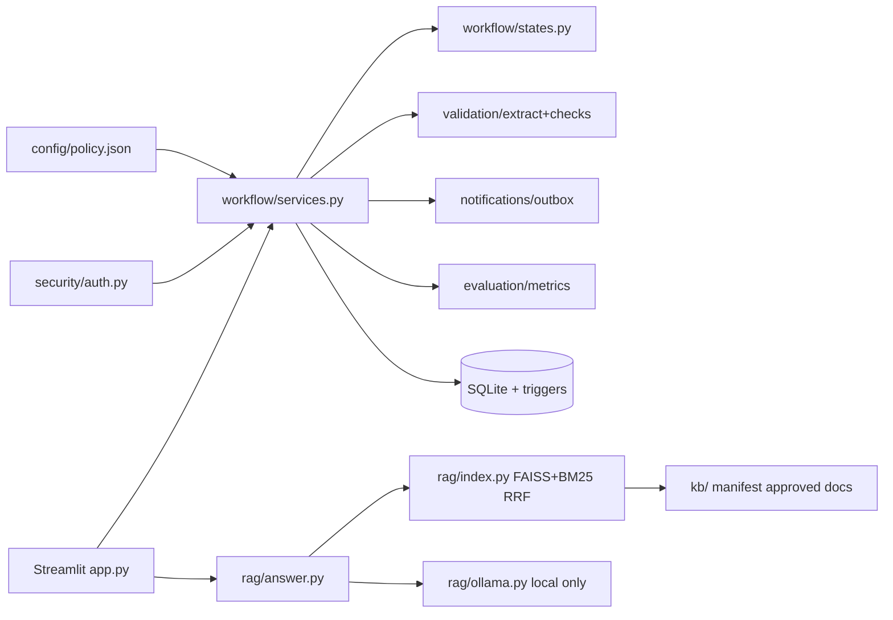
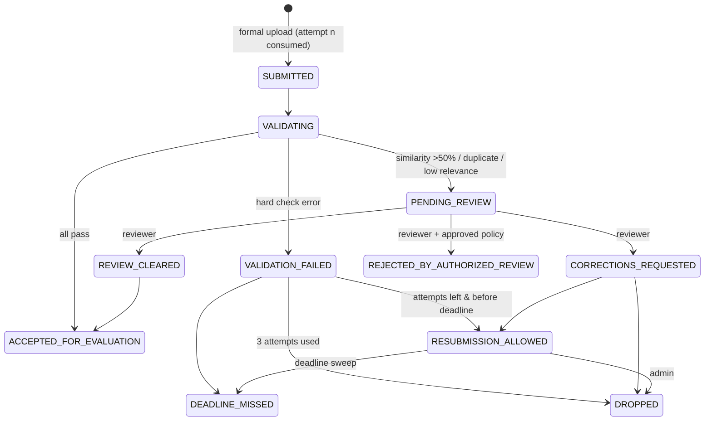

# Phase 1 Incubation RAG Agent

**Start here:**
- Free online portal, nothing to install → **[CLOUD_SETUP.md](CLOUD_SETUP.md)** (GitHub + Streamlit Cloud + Hugging Face)
- On your own Windows PC (local AI with Ollama) → double-click `install_windows.bat`, then `start_portal.bat` ([GETTING_STARTED.md](GETTING_STARTED.md))


> **New here? Start with [GETTING_STARTED.md](GETTING_STARTED.md)** (complete beginner guide, Windows, no Docker).
>
> **Online deployment:** see [DEPLOYMENT.md](DEPLOYMENT.md): Hugging Face Space (Docker, public URL, GitHub auto-deploy)
> or your own PC/server with Docker Compose + a Cloudflare tunnel. The block at the top of this file is the Hugging Face Space configuration.

Streamlit + SQLite + local Ollama. Automates Phase 1: team registration (2–3, locked), domain/PS lock,
abstract submission (PDF/DOCX/PPTX), deterministic validation, originality review (>50% ⇒ human review, never auto-reject),
3-attempt limit, deadlines, reviewer/admin dashboards, audit, notifications outbox, metrics, and a cited policy assistant.

## Quick start
```bash
python -m venv .venv && source .venv/bin/activate        # Windows: .venv\Scripts\activate
pip install -r requirements.txt
cp .env.example .env
ollama serve &                                            # separate terminal is fine
ollama pull mistral && ollama pull nomic-embed-text
python scripts/check_models.py                            # exit 0 = models ready
python scripts/init_db.py --admin-user admin              # migrates DB, loads policy, creates admin
python scripts/ingest.py                                  # builds FAISS+BM25 index from kb/
python -m pytest                                          # test suite
python scripts/evaluate.py                                # RAG + hard-check metrics (persisted)
streamlit run app.py --server.address 127.0.0.1           # http://127.0.0.1:8501
```
Optional: `python scripts/make_samples.py` (synthetic files in `samples/`), `python scripts/acceptance.py --db storage/acceptance.db` (end-to-end check on a separate DB).

Without Ollama the workflow still works; the assistant shows cited approved passages and states that the AI model is unavailable.

## What every abstract is checked for
| # | Check | Result id | Default outcome (admin can change in Programme Setup → Validation checks) |
|---|---|---|---|
| 1 | Related to the selected track (≥ N keywords from track + PS keywords) | `DOMAIN_RELEVANCE` | human review (or fail) |
| 2 | Format: headings **Problem Statement / Motivation, Impact, Methodology, Deliverables / Outcomes**, each with ≥ 15 words | `REQUIRED_SECTIONS`, `SECTION_CONTENT` | fail |
| 3 | Minimum length of the complete document (150–5000 words) | `MIN_WORDS` / `MAX_WORDS` | fail |
| 4 | English | `LANGUAGE` | fail |
| 5 | Similarity with every problem statement in the database (is it closer to another PS than the locked one?) | `PS_SIMILARITY` | human review (or fail) |
| 6 | Duplicates: exact copy of another team's submission | `DUPLICATE_SUBMISSION` | **rejected** (fail) |
|   | Same team re-uploads an identical file/text | `DUPLICATE_OF_PREVIOUS_ATTEMPT` | blocked, no attempt used |
|   | Near-duplicate (≥ 90 % overlap) / similarity > 50 % with another team | `NEAR_DUPLICATE`, `SIMILARITY` | human review (never auto-rejected) |
Plus file type/size/readability. Every failure comes with corrective guidance in the report and in the email.

## Emails: acknowledgements, alerts, reminders
| Event | Recipients |
|---|---|
| Team registered · track/PS locked · submission received | team contact + every member email |
| Validation failed (with the reasons and fixes) · accepted · sent to review · reviewer decision | team contact + members |
| New review case | reviewers/admins that have an email (Users page) |
| Deadline reminders (default 168, 72, 24, 3 h before) | teams that still have to lock a PS, submit or resubmit |
| Review-case reminder (case open > 24 h, once a day) | reviewers + admins with an email |
| Duplicate submission rejected · email permanently undeliverable | admins with an email |
| Student account created (if email given) · staff account created · email address registered | that user |
| Upload refused before it counted (wrong type, re-upload, deadline passed …) · deadline missed | team contact + members |
| Reviewer's own decision (copy) | the reviewer |
| **Organiser update on a submitted draft** (Submissions page → *Send an update to this team*) · **announcement** to a group of teams (Notifications page) | team contact + members; also shown to the team under History; the sender gets a copy |
| Settings / tracks / template / knowledge-base changes · deadline sweep | admins with an email |

1. Put SMTP settings in `.env` (Gmail / Outlook examples inside), restart the app.
2. **Notifications** page → *Send test email*.
3. Keep the worker running for reminders and retries: `python scripts/notify_worker.py --loop 300`
   (or schedule `python scripts/notify_worker.py --once` every 15 min with cron / Task Scheduler).
Emails are queued in the database first; nothing is lost when the mail server or internet is down — they are retried (max 5 attempts) and failures are listed on the Notifications page.

## Admin uploads (no code or restart needed) — sidebar → **Programme Setup**
| What | How | Effect |
|---|---|---|
| **Tracks & problem statements** | Upload CSV / XLSX / JSON (columns `track_id, track_name, ps_id, ps_title` + optional `track_description, track_keywords, ps_description, keywords`). Example: `examples/tracks_problem_statements_example.csv` | Preview + row-level errors before import. *Replace* hides tracks/PS not in the file; *Merge* only adds/updates. Teams that already locked a PS keep it. Published to the assistant as an approved KB document. |
| **Abstract format / template** | Upload the official DOCX / PPTX / PDF template (example: Programme Setup → *Download an example template*, or `python scripts/make_samples.py`) | Headings auto-detected → editable required-sections list, word limits, accepted formats. Students get a download button on the Submit page. |
| **Deadline & rules** | Form: deadline, inclusive second, max file size, approved rejection policies | Applies to new submissions immediately; each change creates a new rules version (`<policy>+admin.rN`) stored on every submission. |
| **Knowledge-base documents** | Knowledge Base page → upload PDF/DOCX/PPTX/MD/TXT with version, type, status, audience; approve/draft/retire | Previous versions archived in `kb/_archive/`; click **Rebuild index** afterwards. |

All uploads are admin-only (enforced in the backend), validated, and recorded in the audit log.
`config/policy.json` still holds the defaults; its sample catalogue is only used to seed an **empty** database.

## Roles
- **student** – self sign-up, register team, lock PS, submit, history, assistant
- **reviewer** – review queue + decisions (created by admin)
- **admin** – dashboard, users, KB/models, outbox, audit log, policy, deadline sweep, reviews

## Architecture


## Submission workflow

Pre-formal rejections (wrong extension, empty file, oversize, MIME mismatch, oversized archive, PS not locked, deadline passed,
pending review, attempts exhausted) **do not** consume an attempt. A corrupted file with a valid header is a formal attempt that fails `FILE_READABLE`.
Gate precedence is `submission.resubmission_precedence` (default: deadline → pending_review → attempts_exhausted).

## Key guarantees (enforced in backend + SQLite triggers)
Locked membership/PS, immutable submission versions and validation results, append-only audit, final review decisions,
`UNIQUE(team, ps, attempt_no)` + `BEGIN IMMEDIATE` for race-safe attempts, role checks in every service, student report redaction of other teams.

## Configuration
`config/policy.json` (versioned; sha recorded in `policy_versions`): team size, attempts, deadline+timezone, file rules, required sections,
word limits, language heuristic, relevance threshold, similarity threshold/methods, approved rejection policies, RAG params, domain/PS catalogue.
`kb/manifest.json`: only `status: approved` documents are indexed; `audience: reviewer` documents are hidden from students.

See `IMPLEMENTATION_PLAN.md`, `TEST_REPORT.md`, `OFFLINE_DEPLOYMENT.md`, `TROUBLESHOOTING.md`.
